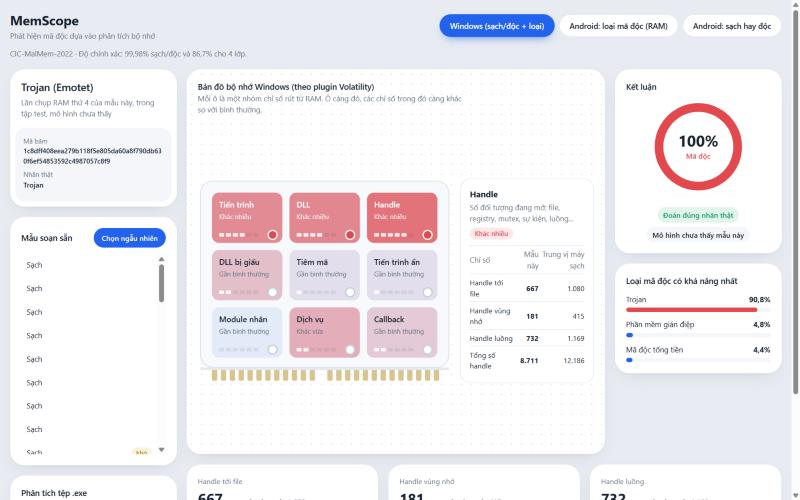
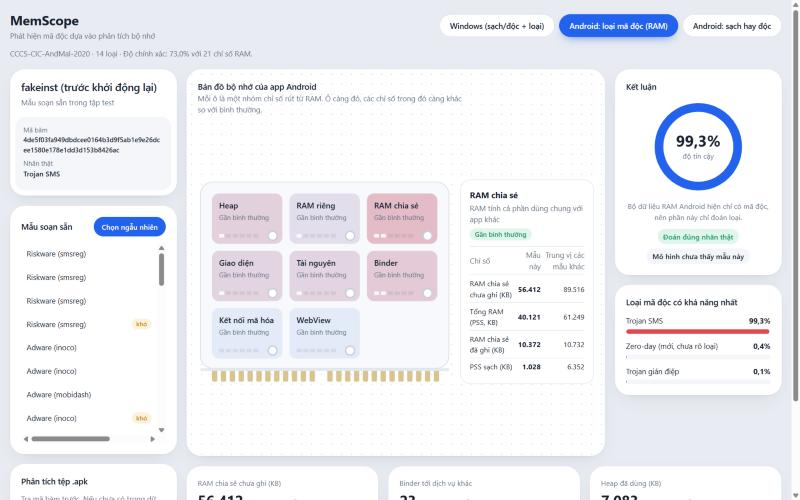

# MemScope

MemScope is an IE105 course project at the University of Information Technology (UIT) that evaluates memory-derived features for malware classification. The local Vietnamese demo lets you inspect held-out Windows and Android measurements, look up an uploaded file by hash, and collect new RAM measurements from verified clean applications in a Windows VM or Android emulator. It ships with the original trained models and feature datasets so the preset demo runs without virtualization.

## Key results

| Task | Dataset and features | Held-out accuracy |
| --- | --- | ---: |
| Windows benign vs. malware | CIC-MalMem-2022, Volatility features | 99.98% |
| Windows four-class classification | CIC-MalMem-2022, Volatility features | 86.7% |
| Android 14-class malware classification | CCCS-CIC-AndMal-2020, RAM only | 73.0% |
| Android 14-class malware classification | CCCS-CIC-AndMal-2020, all dynamic features | 81.9% |
| Android benign vs. malware | CCCS-CIC-AndMal-2020, static features | 98.0% |

The Android RAM tab uses the 21-feature RAM model. [Evaluation details](docs/RESULTS.md) · [Experiment log](docs/EXPERIMENTS.md)

## Quick start

1. Install [64-bit Python 3.12](https://www.python.org/downloads/) on Windows 11 and enable the Python launcher or add Python to PATH.
2. Double-click `run_demo.bat`, or run it from Command Prompt. The launcher creates `app/.venv`, installs the demo dependencies if needed, and opens the browser at `http://127.0.0.1:8000`.
3. Pick a preset or use the random button.
4. To try live analysis, run `app\.venv\Scripts\python.exe scripts\download_samples.py`. It downloads the verified clean demo files (7-Zip `7zr.exe`, Notepad++, three F-Droid apps) into `samples\`. Drop them on the matching page once the Android emulator or VMware guest is set up.

   Step 3 only needs Python; steps 4+ need the virtual machines described in SETUP. To measure a new clean file, set up the corresponding virtual machine and verify the file according to the allowlist instructions. [Full setup and troubleshooting](docs/SETUP.md)

## Real-run evidence

Three clean F-Droid apps were installed and measured in the Android emulator. Each record includes raw `dumpsys meminfo` output, parsed features, step timings, and the model response.

| App | Run record |
| --- | --- |
| Coffee | [JSON](app/results/2026-11-23_ae4688fe.json) |
| Privacy Friendly Dicer | [JSON](app/results/2026-11-23_f2b4d3f0.json) |
| Level | [JSON](app/results/2026-11-23_fbe2fa19.json) |

The archive also includes completed Windows [clean baseline](app/results/windows_2026-11-23_4ba808594d8842558eb23ecd5b336672.json) and [Notepad](app/results/windows_2026-11-23_5151f584be4c4460a338ef127a94d49f.json) runs, plus a Notepad++ run uploaded through the web page ([JSON](app/results/windows_2026-11-23_bf7120352ea843d1bf2ed69c056459c1.json)). See the [live-run results](docs/RESULTS.md#live-run-evidence) for context.

## Screenshots

| Windows page (Trojan sample from the test split) | Android RAM page (Trojan SMS sample) |
| --- | --- |
|  |  |

## Architecture

FastAPI serves the Vietnamese UI and loads native XGBoost artifacts. A dropped file is hashed and compared with the published feature records first. A matching model page displays the dataset result. A hash miss for a verified clean EXE or APK can start a background job that measures guest memory and scores it with the corresponding model. The Android static page looks up stored scores. [Architecture and pipelines](docs/ARCHITECTURE.md)

```text
MemScope/
├── app/
│   ├── server.py                 FastAPI routes and inference
│   ├── android_runner.py          Android Emulator measurements
│   ├── windows_runner.py          VMware and Volatility measurements
│   ├── web/                       Vietnamese demo UI
│   ├── config/                    Verified clean sample hashes
│   ├── data/                      Presets, hash tables, reference statistics
│   ├── models/                    Native XGBoost demo artifacts
│   └── results/                   Live measurement records
├── collection/                    Android meminfo parser and clean data collection
├── data/                          Published feature datasets
├── docs/                          Setup, architecture, experiments, results, safety
├── models/                        Original joblib artifacts
├── results/                       Original experiment outputs
├── scripts/                       Guest provisioning and smoke-run tools
├── requirements.txt               Training dependencies
├── run_demo.bat                   Windows demo launcher
└── LICENSE
```

## Datasets and citations

- **CIC-MalMem-2022** supplies the Windows memory features. Cite Carrier, Victor, Tekeoglu, and Lashkari, *Detecting Obfuscated Malware using Memory Feature Engineering* (ICISSP, 2022). [Dataset](https://www.unb.ca/cic/datasets/malmem-2022.html) · [Paper](https://doi.org/10.5220/0010908200003120)
- **CCCS-CIC-AndMal-2020** supplies the Android dynamic and static features. Cite the dataset and the accompanying *EntropLyzer* and *DIDroid* papers. [Dataset and citation details](data/README.md#cccs-cic-andmal-2020)

## Limitations

- The reported scores come from grouped hold-out splits on lab datasets. Windows 11 and Volatility 3 measurements can differ from the original capture environment.
- The Android RAM classifier learned 14 malware classes. Its output on a clean APK describes the closest modeled class and provides no benign/malware verdict.
- Android static features have anonymized column names. The static tab can score presets or find a stored score by hash. It cannot compute features for a new APK.

## Safety

Use verified clean apps for live measurement and EICAR for harmless file-handling tests. Keep guest environments isolated and the demo bound to loopback. [Safety rules](docs/SAFETY.md)

## Authors

IE105 – Introduction to Information Security · University of Information Technology (UIT), VNU-HCM

Instructor: Dr. Nguyễn Tấn Cầm

- Lê Đình Duy
- Tiến
- Triệu Huy
- Nguyễn Hoàng Hải

## License

Project source code is licensed under the [MIT License](LICENSE). Datasets and third-party software retain their respective terms. [Dataset sources and terms](data/README.md)
