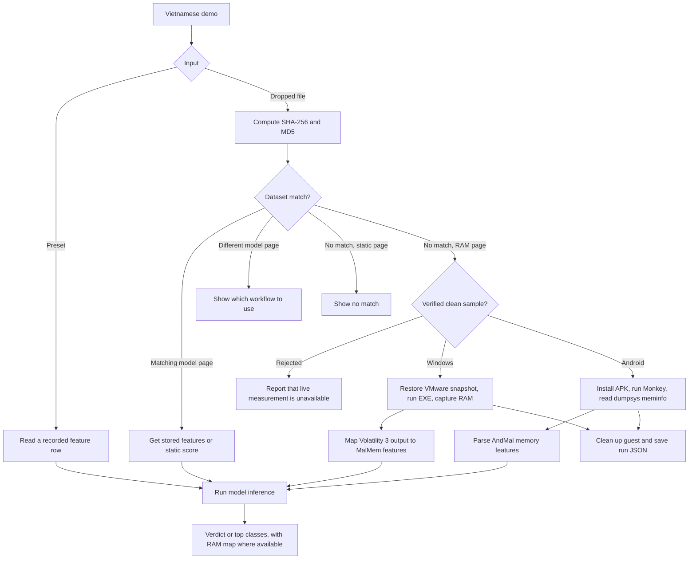

# Architecture

MemScope uses separate feature pipelines for Windows RAM, Android RAM, and Android static analysis. All three share the same local FastAPI app. The published inference artifacts in `app/models/` use native XGBoost serialization and preserve the training feature order. The joblib files in `models/` are used by the experiment utilities.

## Presets and hash lookup

Presets come from the held-out portion of the datasets. The UI shows a 2.4-second staged sequence while presenting the recorded data. For uploads, the server reads the file in chunks and looks for a matching feature record. Windows compares both SHA-256 and MD5 because dataset identifiers may use either. Android uses SHA-256. Static hash results use precomputed scores from the dataset table.

## Live Windows pipeline

The runner serializes VMware jobs and checks guest isolation before and after snapshot restoration. It waits for VMware Tools, runs the sample for 60 seconds, and asks Volatility 3 to parse the suspend memory image using nine plugins. The output contains 55 feature slots, including six missing PsXView fields when their original sources are unavailable. Each model reads its 52 features in metadata order. The map compares the measurement with benign training medians. The evidence compares all measured features with the grouped training set's ranges. [VolMemLyzer reference extractor](https://github.com/ahlashkari/VolMemLyzer/blob/8683ba01ba063480b585680f5bbc60820d0f2860/VolatilityFeatureExtractor.py)

## Live Android pipeline

The runner selects one emulator, installs the verified APK, uses Monkey to generate touches for about 40 seconds by default, and parses `dumpsys meminfo -a` for the package. It stores raw meminfo and 23 AndMal-compatible feature slots. The classifier uses the 21 features in its metadata and displays the three highest-scoring malware categories. The map uses training statistics for the malware-only dataset. The runner uninstalls the app when the job finishes.

## Local API

| Method | Route | Function |
| --- | --- | --- |
| GET | `/api/samples/{platform}` | List presets for `windows`, `android_ram`, or `android_static` |
| GET | `/api/samples/{platform}/{sample_id}` | Score a preset |
| POST | `/api/lookup` | Hash multipart field `file` and look up dataset records |
| POST | `/api/analyze/android` | Queue a clean APK with optional `duration` of 30–45 seconds |
| POST | `/api/analyze/windows` | Queue a clean EXE, or pass `sample=baseline` or `sample=notepad` |
| GET | `/api/jobs/{job_id}` | Read live progress, result, and evidence filename |
